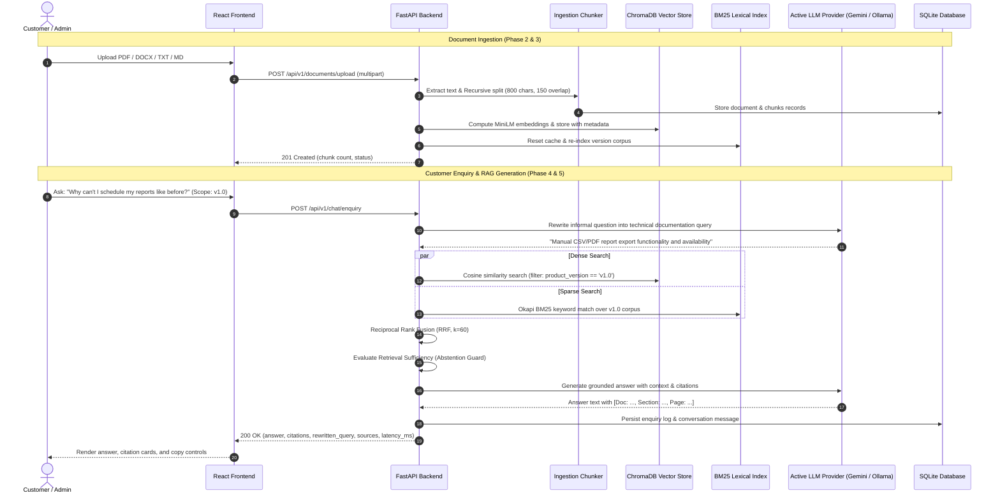

# NexaDesk-RAG System Architecture

**Project Title:** Project 32: RAG-Based Customer Enquiry System over Company Documentation  
**Product:** NexaDesk (SaaS Customer Support & Ticketing Platform)  
**Supported Product Versions:** `v1.0`, `v2.0`, `v3.0`  
**Current Status:** Phases 1–6 Fully Implemented & Verified  

---

## 1. High-Level Architecture Overview

NexaDesk-RAG is a production-grade, modular, full-stack application designed to provide strictly grounded, verifiable, and version-isolated customer support answers from historical and contemporary product documentation.

```mermaid
graph TD
    subgraph Frontend ["Client Tier (React 18 + Vite + Tailwind CSS)"]
        UI["Single Page Application"]
        AdminDash["Admin System Dashboard (DashboardPage.jsx)"]
        ChatComp["Customer Enquiry Assistant (ChatInterface.jsx)"]
        DocComp["Document Catalog & Ingestion (DocumentExplorer.jsx)"]
        AnalyticsComp["Evaluation & Benchmark (AnalyticsView.jsx)"]
        ApiClient["Axios Client (services/apiClient.js)"]

        UI --> AdminDash
        UI --> ChatComp
        UI --> DocComp
        UI --> AnalyticsComp
        AdminDash --> ApiClient
        ChatComp --> ApiClient
        DocComp --> ApiClient
        AnalyticsComp --> ApiClient
    end

    subgraph Backend ["Application Tier (FastAPI)"]
        Router["API Router (/api/v1)"]
        DocService["Document Ingestion Service (PyMuPDF, python-docx)"]
        Pipeline["RAG Pipeline Orchestrator (app/rag/pipeline.py)"]
        EvalService["Evaluation & Benchmark Harness (app/services/evaluation_service.py)"]
        DBModule["SQLite Database Layer (nexadesk.db)"]

        Router --> DocService
        Router --> Pipeline
        Router --> EvalService
        Router --> DBModule
    end

    subgraph RAG_Engine ["Version-Aware Hybrid RAG Subsystem"]
        Rewriter["Query Rewriter (Gemini / Ollama / Heuristic NLP)"]
        ChromaStore["ChromaDB Vector Store (all-MiniLM-L6-v2)"]
        BM25Store["BM25Okapi Lexical Indexer"]
        RRF["Reciprocal Rank Fusion (RRF, k=60)"]
        Guard["Sufficiency & Abstention Guard"]
        LLMFactory["Interchangeable LLM Provider Factory"]

        Pipeline --> Rewriter
        Pipeline --> ChromaStore
        Pipeline --> BM25Store
        Pipeline --> RRF
        Pipeline --> Guard
        Pipeline --> LLMFactory
    end

    subgraph LLM_Providers ["Pluggable LLM Engines"]
        Gemini["Google Gemini Provider (gemini-1.5-flash)"]
        Ollama["Local Ollama Provider (llama3 / mistral via REST API)"]
        Fallback["Grounded Extractive Fallback Engine"]

        LLMFactory --> Gemini
        LLMFactory --> Ollama
        LLMFactory --> Fallback
    end

    subgraph Storage ["Storage & Persistence Tier"]
        SQLiteDB[("SQLite Database (nexadesk.db)")]
        ChromaDisk["ChromaDB Vector Storage (storage/chroma_db/)"]
        UploadDisk["Raw File Storage (storage/uploads/)"]
        BenchmarkDisk["Evaluation Reports (data/evaluation/results/)"]

        DBModule --> SQLiteDB
        ChromaStore --> ChromaDisk
        DocService --> UploadDisk
        EvalService --> BenchmarkDisk
    end

    ApiClient -->|HTTP / JSON (CORS Enabled)| Router
```

---

## 2. Component Breakdown

### 2.1 Client Tier (`frontend/`)
- **Technology:** React 18, Vite 5, Tailwind CSS, Axios, Lucide React.
- **Modules:**
  - `components/dashboard/`: System health cards, component diagnostics, and real-time activity feeds.
  - `components/chat/`: Customer assistant supporting version scope switches, verifiable citation cards, answer copying, and human escalation triggers.
  - `components/documents/`: Document catalog with multi-format upload (PDF, DOCX, TXT, MD), chunk inspection modal, and cascaded deletion.
  - `components/analytics/`: Operational metrics, RAG Triad benchmark execution, latency percentiles, and 3-way retrieval comparison matrix.
  - `services/`: Clean decoupled Axios client layer (`apiClient`, `chatService`, `documentService`, `analyticsService`, `ragService`, `healthService`).

### 2.2 Application Backend (`backend/app/`)
- **Framework:** FastAPI with Uvicorn ASGI server.
- **Key Modules:**
  - `app/api/v1/`: Modular route controllers (`chat.py`, `documents.py`, `rag.py`, `analytics.py`, `health.py`, `system.py`).
  - `app/services/`: Core business logic (`document_service.py`, `evaluation_service.py`, `health_service.py`).
  - `app/rag/`: Search and generation engine (`pipeline.py`, `hybrid_retriever.py`, `query_rewriter.py`, `generator.py`, `vector_store.py`, `bm25_retriever.py`).
  - `app/rag/providers/`: Pluggable LLM interface with `GeminiProvider` and `OllamaProvider`.
  - `app/database/`: SQLite schema, migration triggers, and thread persistence.

### 2.3 Retrieval & Generation Engine
1. **Query Rewriting:** Converts colloquial customer phrasing into technical documentation syntax via LLM or heuristic normalization.
2. **Version-Aware Metadata Filtering:** Enforces hard boundary isolation where vectors are filtered via `product_version == selected_version`.
3. **Dense Retrieval:** ChromaDB semantic vector search using `sentence-transformers/all-MiniLM-L6-v2` (384 dimensions).
4. **Sparse Retrieval:** BM25Okapi lexical retrieval with domain-specific tokenization and stop-word filtering.
5. **Reciprocal Rank Fusion (RRF):** Interleaves dense and sparse rank lists using standard constant $k=60$.
6. **Sufficiency & Abstention Guard:** Assesses dense and sparse confidence scores. Automatically declines to answer and offers human escalation on out-of-domain inquiries.
7. **Interchangeable Generation:** Synthesizes customer-friendly answers citing exact document name, version, section title, and page number.

---

## 3. Data Flow


