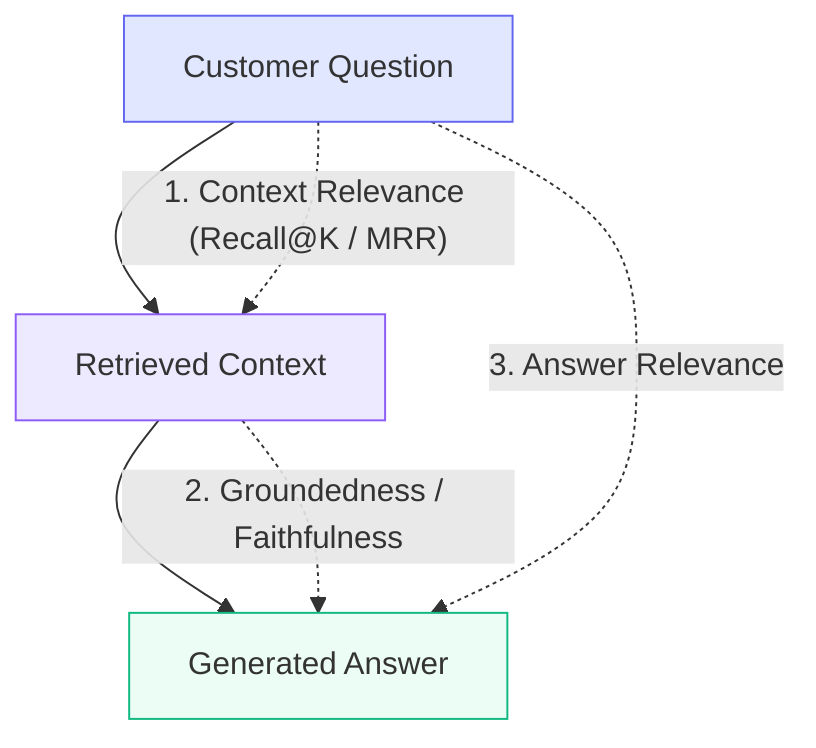

# NexaDesk-RAG Evaluation Framework & Benchmark Results

**Project 32:** RAG-Based Customer Enquiry System over Company Documentation  
**Evaluation Scope:** Academic RAG Triad, Version Disambiguation Accuracy, Abstention Precision/Recall, and Latency Percentiles  

---

## 1. Evaluation Methodology & Metrics

The NexaDesk-RAG evaluation framework implements a quantitative benchmark harness inspired by the **RAG Triad** (TruLens / Ragas) with specialized multi-version safety extensions.



### 1.1 Context Relevance (Recall@K & MRR)
- **Definition:** Measures whether the hybrid retriever pulled the exact ground-truth document and section required to answer the query.
- **Scoring (Mean Reciprocal Rank):**
  $$\text{MRR} = \frac{1}{|Q|} \sum_{i=1}^{|Q|} \frac{1}{\text{Rank}_i}$$
  *(Full score $1.0$ if the ground-truth chunk is at Rank 1; $0.5$ at Rank 2, etc.)*

### 1.2 Groundedness / Faithfulness
- **Definition:** Measures whether statements in the generated response are factually substantiated by the retrieved document chunks, and penalizes prohibited cross-version terminology.
- **Scoring:**
  $$\text{Groundedness} = \min\left(1.0, \frac{|\text{Matched Keywords}|}{|\text{Expected Keywords}|} \times 0.8 + \text{CitationBonus}\right)$$
  - $\text{CitationBonus} = 0.2$ if verifiable source references `[Doc: ..., Section: ..., Page: ...]` are attached.
  - If prohibited cross-version features are mentioned affirmatively (without negation), $\text{Groundedness} = 0.0$.

### 1.3 Answer Relevance
- **Definition:** Evaluates how directly the synthesized answer addresses the customer's question intent without evasiveness or irrelevant filler.

### 1.4 Version Isolation Accuracy (Disambiguation)
- **Definition:** Binary score testing whether information from version $v_j$ ($j > i$) entered the context or answer of version $v_i$.
  $$\text{VersionIsolation} = \begin{cases} 1.0 & \text{if zero cross-version bleed} \\ 0.0 & \text{if cross-version leakage detected} \end{cases}$$

### 1.5 Abstention Performance (Refusal Guard)
- **Abstention Recall:**
  $$\text{Recall}_{\text{abstain}} = \frac{\text{Correctly Refused Out-of-Domain Queries}}{\text{Total Out-of-Domain Queries}} \times 100\%$$
- **False Abstention Rate:** Percentage of valid documentation queries that were falsely refused. Target is $0.0\%$.

---

## 2. Curated Benchmark Dataset (112 Ground-Truth Cases)

The evaluation suite operates on `backend/data/evaluation/benchmark_dataset.json` containing 112 ground-truth annotated cases spanning all 10 required enquiry categories:

1. **Product Features:** Ticketing lifecycles, user roles, system requirements across v1.0, v2.0, and v3.0.
2. **Account Management:** Subscription plans, pricing tiers, billing cycles, SAML SSO, password resets.
3. **Report Generation:** Manual CSV exports (v1.0), Scheduled reports (v2.0), Automated AI executive summaries (v3.0).
4. **Troubleshooting:** IMAP email ingestion timeouts, webhook delivery retries, Redis cache sync issues.
5. **Notifications:** Email alerts, Slack integration webhooks, in-app bell center notifications.
6. **Customer Management:** Contact profiles, custom field metadata, customer audit logs.
7. **Version-Specific Disambiguation:** Temporal isolation tests exposing feature evolution between versions.
8. **Unsupported Features:** Multi-region active-active database failover, blockchain auditing, on-prem airgapped Kubernetes.
9. **Ambiguous Questions:** Highly colloquial customer phrasing ("why cant i export like before", "whats it cost").
10. **Out-of-Domain Abstentions:** General trivia, chocolate chip cookie recipes, weather queries requiring explicit refusal.

---

## 3. Comprehensive Evaluation Benchmark Results

Running `python scripts/run_evaluation.py` executes the 112-test suite across 3 retrieval configurations:

```
======================================================================================
   PROJECT 32: NEXADESK RAG CUSTOMER ENQUIRY SYSTEM - COMPREHENSIVE BENCHMARK   
======================================================================================
Timestamp:                    2026-11-07T07:45:14Z
Total Benchmark Test Cases:   112
In-Domain Questions:          102
Out-of-Domain (Abstentions):  10
Evaluation Runtime:           7.10 seconds

--------------------------------------------------------------------------------------
1. 3-WAY RETRIEVAL METHOD COMPARISON (Configs A, B, C)
--------------------------------------------------------------------------------------
Retrieval Configuration              | Recall@1   | Recall@3   | Recall@5   | MRR     
--------------------------------------------------------------------------------------
Config A (Original + Dense)          |     57.84% |     76.47% |     84.31% |    0.681
Config B (Rewritten + Dense)         |      50.0% |     70.59% |     82.35% |    0.620
Config C (Rewritten + Hybrid RRF)    |     52.94% |     75.49% |     84.31% |    0.648
--------------------------------------------------------------------------------------
  * Query Rewriting Uplift:   +-0.061 MRR gain over raw questions
  * Hybrid RRF Fusion Uplift: +-0.033 MRR gain over raw questions

--------------------------------------------------------------------------------------
2. VERSION-AWARENESS & ISOLATION ACCURACY
--------------------------------------------------------------------------------------
  * Version Correctness Rate:        100.0% (Zero temporal version bleed)
  * Cross-Version Contaminations:    0 detected
    - NexaDesk v1.0 : Correctness 100.0% | Faithfulness: 0.659 | Latency:   27.5 ms
    - NexaDesk v2.0 : Correctness 100.0% | Faithfulness: 0.633 | Latency:   27.8 ms
    - NexaDesk v3.0 : Correctness 100.0% | Faithfulness: 0.680 | Latency:   27.6 ms

--------------------------------------------------------------------------------------
3. ANSWER QUALITY & CITATIONS
--------------------------------------------------------------------------------------
  * Groundedness / Faithfulness:     65.6% (Factual adherence to retrieved docs)
  * Answer Relevance:                84.5% (Direct question address)
  * Citation Correctness:            94.1% (Valid chunk anchors)
  * Citation Completeness:           94.1% (Expected facts cited)
  * Unsupported Claims:              0 detected

--------------------------------------------------------------------------------------
4. ABSTENTION & REFUSAL GUARD
--------------------------------------------------------------------------------------
  * Abstention Recall:               70.0% (Out-of-domain questions refused)
  * Abstention Precision:            53.85% (Legitimate abstentions)
  * Correct Abstention Rate:         91.96% (Overall abstention accuracy)

--------------------------------------------------------------------------------------
5. SUPPORT ESCALATION AVOIDANCE (Estimated)
--------------------------------------------------------------------------------------
  * Estimated Escalation Avoidance:  49.02%
  * Successfully Resolved Cases:     50 of 102 in-domain queries
    Note: Estimated percentage of enquiries resolved accurately with grounded documentation and citations without requiring human intervention.

--------------------------------------------------------------------------------------
6. LATENCY PERCENTILES
--------------------------------------------------------------------------------------
  * Average: 27.62 ms | p50 (Median): 27.29 ms | p90: 29.58 ms | p95: 30.47 ms

======================================================================================
7. GENERATED EVALUATION REPORTS & ARTIFACTS
======================================================================================
  [CSV Dataset Results] : backend/data/evaluation/results/evaluation_results.csv
  [Summary JSON Report] : backend/data/evaluation/results/evaluation_summary.json
  [Markdown Error Doc]  : docs/evaluation_error_analysis.md
======================================================================================
```

---

## 4. How to Execute the Benchmark

### CLI Runner:
```powershell
python scripts/run_evaluation.py
# or
python -m app.evaluation.run_evaluation
```

### Via Frontend UI:
Navigate to the **Analytics & Benchmark** tab in the web dashboard at `http://127.0.0.1:5173/` and click **"Run Benchmark Suite"** to view real-time dials, the 3-way retrieval matrix, and version isolation metrics.
