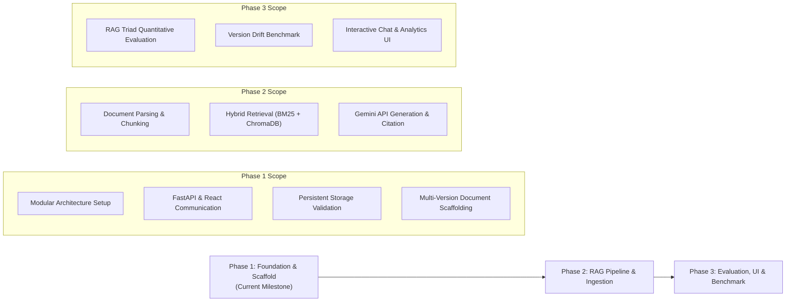

# NexaDesk-RAG Project Methodology

**Project 32:** RAG-Based Customer Enquiry System over Company Documentation  
**Academic Focus:** Multi-Version Knowledge Disambiguation, Hybrid Retrieval, Grounded Generation

---

## 1. Problem Statement & Motivation

Customer enquiry systems in SaaS environments often suffer from **temporal version drift**. Software products undergo rapid iterations (e.g., NexaDesk v1.0 $\rightarrow$ v2.0 $\rightarrow$ v3.0), where:
1. Features are introduced, deprecated, or replaced (e.g., POP3 polling in v1.0 was replaced by Webhooks in v2.0 and NexaFlow Studio in v3.0).
2. Pricing tiers and SLA commitments change.
3. Standard RAG architectures frequently hallucinate or blend information from multiple versions when answering queries like *"How do I configure email ticketing?"* or *"What are the plan limits?"*

The primary goal of this capstone is to design, implement, and rigorously evaluate a version-aware Retrieval-Augmented Generation (RAG) system that guarantees strict contextual isolation and factual consistency.

---

## 2. Multi-Phase Implementation Roadmap

The project follows a structured three-phase development lifecycle:



---

## 3. RAG Pipeline Methodology

### 3.1 Document Ingestion & Chunking Strategy
- **Recursive Character Text Splitting:** Documents are split with a chunk size of 512 tokens and an overlap of 64 tokens to preserve contextual continuity.
- **Hierarchical Metadata Tagging:** Every chunk is enriched with:
  ```json
  {
    "product": "NexaDesk",
    "version": "v2.0",
    "document_title": "automations_and_routing.md",
    "section": "Automation Triggers",
    "chunk_id": "v2.0_auto_001"
  }
  ```

### 3.2 Hybrid Retrieval Formulation
To overcome the limitations of pure semantic search on technical terms (e.g., error codes, API names) and the semantic blindness of keyword search, a hybrid retrieval formula is employed:

$$\text{Score}(d, q) = \alpha \cdot \text{Score}_{\text{dense}}(d, q) + (1 - \alpha) \cdot \text{Score}_{\text{BM25}}(d, q)$$

Where:
- $\text{Score}_{\text{dense}}$ is cosine similarity using Sentence Transformers.
- $\text{Score}_{\text{BM25}}$ is normalized Okapi BM25 score.
- $\alpha \in [0, 1]$ is a tunable interpolation parameter (default $\alpha = 0.6$).
- Metadata filter: $\text{version} == \text{target\_version}$.

### 3.3 Prompt Engineering & Source Citation
Prompts strictly instruct the model to ground answers solely within retrieved passages from the selected version and explicitly decline to answer if the information is unavailable in that specific version release.

